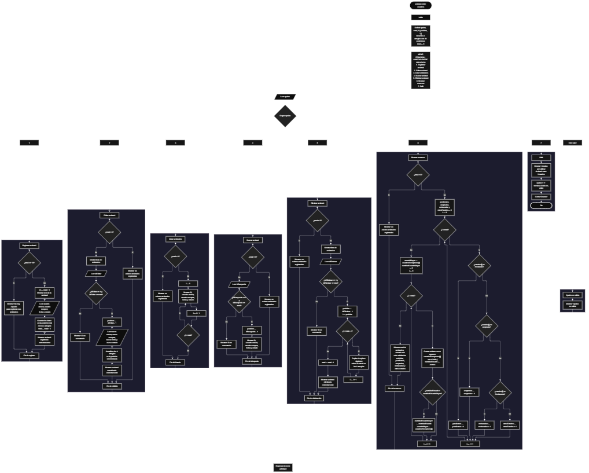

Este proyecto, llamado <b>amistad entre usuarios</b>, fue desarrollado en <b>java</b> como un ejercicio práctico para fortalecer la lógica de programación mediante la creación de un sistema de gestión de solicitudes de amistad desde la consola. El programa cuenta con un menú principal de siete opciones que permite <b>registrar, editar, listar, buscar, eliminar y consultar el resumen</b> de las amistades registradas. Cada amistad almacena datos como el usuario que envía la solicitud, el usuario que la recibe, la fecha de la solicitud y el estado de la amistad, utilizando arreglos con una capacidad máxima de <b>10 amistades durante la ejecución</b>. Durante su desarrollo se aplicaron conceptos fundamentales de programación, como variables, arreglos, estructuras condicionales, ciclos repetitivos y estructuras de selección, además de procesos para buscar, modificar, eliminar, contar y organizar registros. Este proyecto permite poner en práctica los conocimientos adquiridos en Java y sirve como base para desarrollar sistemas de gestión más avanzados utilizando otros lenguajes y tecnologías.

<h2 align="center">⚙️ Funcionamiento del menú principal</h2>

### ➕ Registrar amistad

La opción <b>1) registrar amistad</b> permite almacenar una nueva solicitud de amistad entre dos usuarios. Antes de realizar el registro, el sistema comprueba que exista espacio disponible mediante la condición <b>total &gt;= usuariosEmisores.length</b>. Si el arreglo está lleno, muestra el mensaje <b>"No hay espacio para registrar mas amistades."</b> y regresa al menú. Si existe espacio, calcula el ID de la nueva amistad con la expresión <b>total + 1</b>, lo muestra en pantalla y solicita el <b>nombre del usuario que envía la solicitud, el nombre del usuario que la recibe, la fecha de la solicitud y el estado de la amistad</b>. Los datos se almacenan en la posición <b>total</b> de sus respectivos arreglos. Finalmente, muestra el mensaje <b>"Amistad registrada correctamente."</b> y aumenta la variable <b>total</b> en uno.

### ✏️ Editar amistad

La opción <b>2) editar amistad</b> permite modificar la información de una amistad registrada. Primero, el programa comprueba si existen amistades almacenadas mediante la variable <b>total</b>. Si no hay registros, muestra el mensaje <b>"No existen amistades registradas."</b>. En caso contrario, presenta una lista con el ID, usuario emisor, usuario receptor, fecha y estado de cada amistad. Después, solicita el ID de la amistad que se desea editar y comprueba que esté dentro del rango permitido mediante la condición <b>idEditar &gt;= 1 &amp;&amp; idEditar &lt;= total</b>. Si la selección es válida, calcula la posición con <b>idEditar - 1</b>, solicita el nuevo usuario emisor, el nuevo usuario receptor, la nueva fecha y el nuevo estado, y actualiza directamente los valores de los arreglos correspondientes. Finalmente, presenta el mensaje <b>"Amistad actualizada correctamente."</b>. Si el ID no corresponde a una amistad registrada, muestra el mensaje <b>"ID no encontrada."</b>.

### 📋 Listar amistades

La opción <b>3) listar amistades</b> permite visualizar todas las amistades registradas actualmente. Antes de mostrar la información, el programa comprueba si la variable <b>total</b> es igual a cero. Si no existen registros, presenta el mensaje <b>"No existen amistades registradas."</b>. Si hay amistades disponibles, utiliza un ciclo <b>for</b> para recorrer los arreglos desde la posición cero hasta <b>total - 1</b>. Durante el recorrido, muestra el ID, el usuario emisor, el usuario receptor, la fecha y el estado de cada amistad en una sola línea. Esta función facilita consultar los registros existentes sin necesidad de buscar cada amistad individualmente.

### 🔎 Buscar amistad

La opción <b>4) buscar amistad</b> permite localizar una amistad mediante su ID. Primero, el programa comprueba si existen amistades registradas. Si no hay registros, muestra el mensaje <b>"No existen amistades registradas."</b>. En caso contrario, solicita el ID de la amistad que se desea buscar y verifica que esté dentro del rango válido mediante la condición <b>idBusqueda &gt;= 1 &amp;&amp; idBusqueda &lt;= total</b>. Si el ID es válido, calcula la posición con <b>idBusqueda - 1</b> y muestra el mensaje <b>"Datos de la amistad encontrada:"</b> junto con el ID, el usuario emisor, el usuario receptor, la fecha y el estado. Si el ID no corresponde a ninguna amistad, presenta el mensaje <b>"ID no encontrada."</b>.

### 🗑️ Eliminar amistad

La opción <b>5) eliminar amistad</b> permite eliminar una amistad registrada mediante su ID. Antes de comenzar, el programa comprueba que existan amistades almacenadas. Si no hay registros, muestra el mensaje <b>"No existen amistades registradas."</b>. Si hay registros disponibles, presenta una lista con los datos de cada amistad y solicita el ID de la que se desea eliminar. Si el ID está dentro del rango válido, calcula la posición con <b>idEliminar - 1</b> y utiliza un ciclo <b>for</b> controlado por la variable <b>i</b>, que comienza en la posición seleccionada y llega hasta <b>total - 2</b>, desplazando una posición hacia atrás los datos de las amistades posteriores en los arreglos <b>usuariosEmisores, usuariosReceptores, fechas y estados</b>. Posteriormente, disminuye la variable <b>total</b> en uno y muestra el mensaje <b>"Amistad eliminada correctamente."</b>. Como el ID se calcula a partir de la posición, al eliminar una amistad los IDs de las siguientes se reducen en uno. Si el ID no corresponde a una amistad registrada, informa <b>"ID no encontrada."</b>.

### 📊 Mostrar resumen

La opción <b>6) mostrar resumen</b> presenta un panorama general de las amistades registradas. Primero, el programa comprueba si existen registros. Si la lista está vacía, muestra el mensaje <b>"No existen amistades registradas."</b>. En caso contrario, inicializa los contadores <b>pendientes, aceptadas, rechazadas y otrosEstados</b> en cero y recorre el arreglo <b>estados</b> con un ciclo <b>for</b>, comparando cada valor con las palabras <b>"Pendiente", "Aceptada" y "Rechazada"</b> mediante el método <b>equalsIgnoreCase</b>, que ignora las diferencias entre mayúsculas y minúsculas. Cualquier otro valor se cuenta en <b>otrosEstados</b>. Después, utiliza un doble ciclo <b>for</b> para contar cuántas veces aparece cada usuario receptor y determinar cuál recibió más solicitudes, guardándolo en la variable <b>usuarioMayor</b>. Finalmente, muestra la cantidad de amistades registradas, el usuario con más solicitudes recibidas, las solicitudes pendientes, las amistades aceptadas, las solicitudes rechazadas y los otros estados.

### 🚪 Salir del menú principal

La opción <b>7) salir</b> finaliza la ejecución del programa y muestra el mensaje <b>"Gracias por utilizar Amistad entre Usuarios."</b>. El menú principal se encuentra dentro de una estructura repetitiva <b>do ... while</b>, que mantiene el programa en funcionamiento mientras se cumpla la condición <b>opcion != 7</b>. De esta forma, al seleccionar la opción 7 el ciclo termina, se cierra el objeto <b>Scanner</b> con <b>entrada.close()</b> y el programa finaliza correctamente.

<h2 align="center">🧠 Temas aplicados en el proyecto</h2>

### 📦 Variables

En este proyecto se utilizan variables para guardar la opción seleccionada en el menú, controlar la cantidad de amistades registradas, calcular el ID de cada amistad, seleccionar las amistades que se desean editar, buscar o eliminar, contar los estados de las solicitudes y determinar el usuario que más solicitudes recibió. Cada variable cumple una función específica dentro de las operaciones de gestión de amistades.

🔢 **opcion:** Almacena la opción seleccionada por el usuario en el menú principal.

📊 **total:** Almacena la cantidad actual de amistades registradas.

🆔 **id:** Almacena el ID calculado para la nueva amistad al registrarla.

🔄 **i y j:** Funcionan como contadores en los ciclos <b>for</b> para recorrer los arreglos, desplazar datos al eliminar y comparar usuarios en el resumen.

📍 **idEditar, idBusqueda e idEliminar:** Almacenan el ID introducido por el usuario en cada operación.

📌 **posicion:** Almacena la posición real dentro de los arreglos, calculada como el ID menos uno.

🧮 **pendientes, aceptadas, rechazadas y otrosEstados:** Contadores utilizados en el resumen para clasificar las solicitudes según su estado.

🏆 **usuarioMayor, cantidadUsuarioMayor y cantidadUsuario:** Permiten determinar qué usuario receptor tiene más solicitudes recibidas.

⌨️ **entrada:** Objeto <b>Scanner</b> utilizado para leer los datos escritos por el usuario en la consola.

### 🗃️ Arreglos

En este proyecto se utilizan cuatro arreglos paralelos relacionados con los datos de cada amistad. Cada arreglo tiene una capacidad de <b>10 posiciones</b> y utiliza el mismo índice para representar la información correspondiente a una misma amistad. Por ejemplo, los datos de la amistad almacenada en la posición <b>0</b> se encuentran distribuidos entre <b>usuariosEmisores[0], usuariosReceptores[0], fechas[0] y estados[0]</b>. Esta organización permite recorrer, buscar, modificar, mostrar y eliminar las amistades de manera ordenada.

📝 **usuariosEmisores[10]:** Almacena los nombres de los usuarios que envían la solicitud.

📨 **usuariosReceptores[10]:** Almacena los nombres de los usuarios que reciben la solicitud.

📅 **fechas[10]:** Almacena la fecha de cada solicitud.

🤝 **estados[10]:** Almacena el estado de cada amistad, como pendiente, aceptada o rechazada.

### 🔀 Estructuras condicionales

En este proyecto se utilizan las estructuras <b>if</b> y <b>else</b> para comprobar si hay espacio disponible antes de registrar una amistad, verificar si existen registros antes de realizar determinadas operaciones, validar el ID seleccionado para editar, buscar o eliminar una amistad y clasificar los estados en el resumen mediante la cadena <b>if ... else if ... else</b>. Estas condiciones permiten que el programa responda de manera diferente según el estado de la lista y el resultado de cada operación.

### 🔄 Estructuras repetitivas

En este proyecto se utilizan los ciclos <b>for</b> y <b>do ... while</b>. Los ciclos <b>for</b> permiten recorrer los arreglos para mostrar las amistades, contar estados, comparar usuarios receptores y desplazar los datos durante la eliminación. Por otro lado, el ciclo <b>do ... while</b> mantiene activo el menú principal para que el usuario pueda ejecutar diferentes operaciones antes de salir del programa.

### 🎯 Estructura switch

El programa evalúa el valor almacenado en la variable <b>opcion</b> mediante la estructura <b>switch</b> y ejecuta el bloque de instrucciones correspondiente. Cada caso representa una operación específica del sistema: <b>registrar, editar, listar, buscar, eliminar, mostrar resumen o salir</b>. También se utiliza el bloque <b>default</b> para mostrar el mensaje <b>"Opcion no valida."</b> cuando el valor introducido no coincide con ninguna de las opciones definidas.

### 🔢 Dimensionamiento de arreglos

El programa utiliza la instrucción <b>new String[10]</b> para establecer la capacidad de los arreglos que almacenan la información de las amistades. Se definieron <b>10 posiciones</b> para cada arreglo, lo que permite administrar hasta 10 amistades durante la ejecución. La cantidad de posiciones ocupadas se controla mediante la variable <b>total</b>, por lo que las operaciones recorren únicamente los registros comprendidos entre la posición cero y el total actual de amistades.

### 🔄 Reorganización de registros

Cuando se selecciona una amistad para eliminarla, el programa utiliza un ciclo <b>for</b> que comienza en la posición seleccionada y llega hasta <b>total - 2</b>. En cada repetición, los datos de la posición siguiente se copian sobre la posición actual en los cuatro arreglos: <b>usuariosEmisores, usuariosReceptores, fechas y estados</b>. Después, la variable <b>total</b> disminuye en uno. De esta manera, las amistades posteriores ocupan las posiciones disponibles sin dejar espacios vacíos entre los registros activos.

### 🧾 Lectura de datos con Scanner

El programa utiliza la clase <b>Scanner</b> para leer los datos que escribe el usuario. Los números se leen con <b>nextInt()</b> y los textos con <b>nextLine()</b>. Después de cada lectura numérica se agrega una instrucción <b>entrada.nextLine()</b> para limpiar el salto de línea que queda en el buffer, evitando que el siguiente texto se lea vacío.

<h2 align="center">¿Cómo se implementaron las operaciones crud en el proyecto?</h2>

Las operaciones <b>crud</b> se implementaron mediante las opciones del menú principal, permitiendo administrar las amistades registradas. La operación <b>crear</b> corresponde a <b>registrar amistad</b>, donde se introducen los datos de una nueva solicitud; <b>leer</b> se realiza mediante las opciones <b>listar amistades, buscar amistad y mostrar resumen</b>; <b>actualizar</b> corresponde a <b>editar amistad</b>, donde se modifican los datos de una amistad registrada; y <b>eliminar</b> se realiza mediante la opción <b>eliminar amistad</b>. Estas operaciones utilizan variables, arreglos, condicionales y ciclos para gestionar la información almacenada temporalmente durante la ejecución del programa.

<h2 align="center">Diagrama de flujo del proyecto</h2>

<h2 align="center">🛡️ Validaciones del programa</h2>

### 📭 No existen amistades registradas

Esta validación se utiliza en las opciones de <b>editar, listar, buscar, eliminar y mostrar resumen</b>. El programa comprueba si la variable <b>total</b> es igual a <b>0</b> y, si no existen amistades registradas, muestra el mensaje <b>"No existen amistades registradas."</b>. Esta comprobación evita continuar con las operaciones que necesitan información almacenada cuando la lista está vacía.

### ⚠️ Sin espacio para registrar

Esta validación se utiliza durante el registro de nuevas amistades para controlar la capacidad máxima de los arreglos. El programa comprueba si <b>total &gt;= usuariosEmisores.length</b> antes de permitir agregar un nuevo registro. Si no existe espacio, muestra el mensaje <b>"No hay espacio para registrar mas amistades."</b> y regresa al menú. En caso contrario, calcula el ID y solicita los datos de la amistad.

### ❌ ID no encontrada

Esta validación se utiliza en las opciones de <b>editar, buscar y eliminar</b>. El programa verifica que el ID introducido sea mayor o igual a <b>1</b> y menor o igual al valor de <b>total</b>. Si el ID está fuera de ese rango, muestra el mensaje <b>"ID no encontrada."</b>. Esta validación evita modificar, consultar o eliminar posiciones que no corresponden a amistades registradas.

### ⚠️ Opción inválida

La estructura <b>switch</b> incluye el bloque <b>default</b>, que muestra el mensaje <b>"Opcion no valida."</b> cuando el usuario introduce un número que no corresponde a ninguna de las opciones definidas en el menú. Después de mostrar el mensaje, el programa vuelve a presentar el menú principal.

### 🔤 Estados no reconocidos

El estado de la amistad se escribe manualmente. En el resumen, el programa clasifica los estados reconocidos (<b>Pendiente, Aceptada y Rechazada</b>) sin distinguir entre mayúsculas y minúsculas. Cualquier otro texto se contabiliza en la categoría <b>otros estados</b>, lo que evita que el conteo se pierda cuando se escribe un valor distinto.

### 📝 Limitaciones conocidas

En la versión actual, el programa no valida que el usuario escriba un número cuando se solicita la opción del menú o un ID; si se introduce una letra, se produce un error de ejecución (<b>InputMismatchException</b>). Además, el ID de cada amistad depende de su posición, por lo que cambia cuando se elimina un registro anterior. Estas mejoras pueden implementarse en futuras versiones del proyecto.

<h2 align="center">🎯 Objetivo del proyecto</h2>

El objetivo principal de este proyecto es fortalecer la <b>lógica de programación</b> mediante el desarrollo de un sistema de gestión de amistades entre usuarios en <b>java</b>. A través de su construcción se busca aplicar los conocimientos adquiridos sobre variables, arreglos, estructuras condicionales, ciclos repetitivos y estructuras de selección, integrándolos para resolver un problema de manera organizada. Además, el proyecto permite comprender cómo registrar, consultar, modificar y eliminar información en una aplicación de consola, estableciendo una base para desarrollar sistemas de gestión más completos con otros lenguajes y tecnologías.

